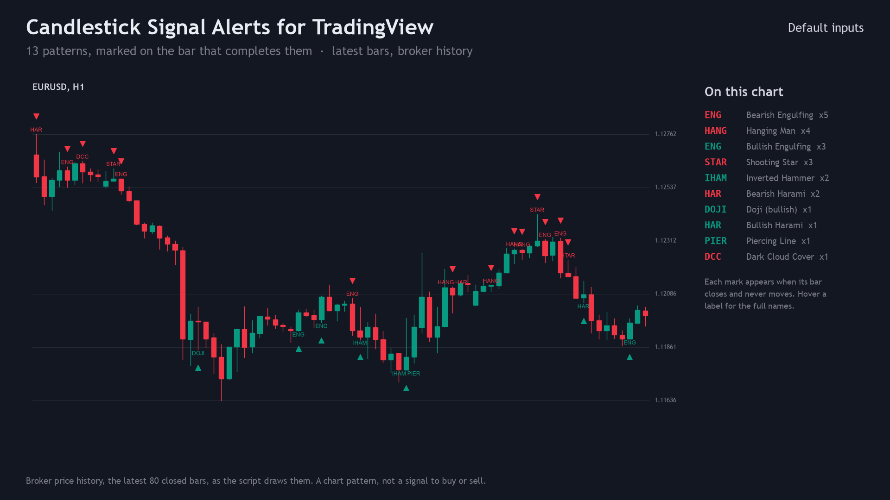
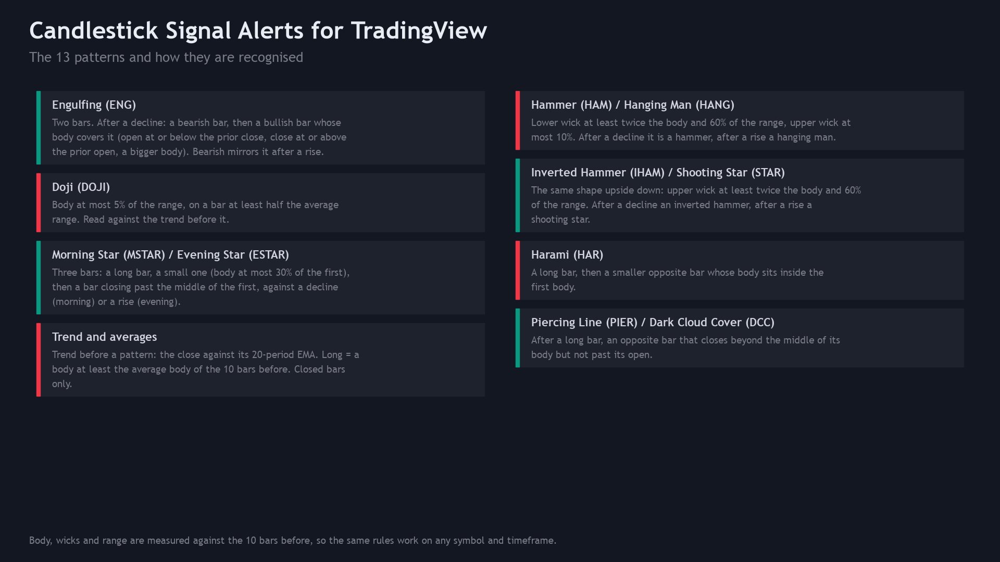
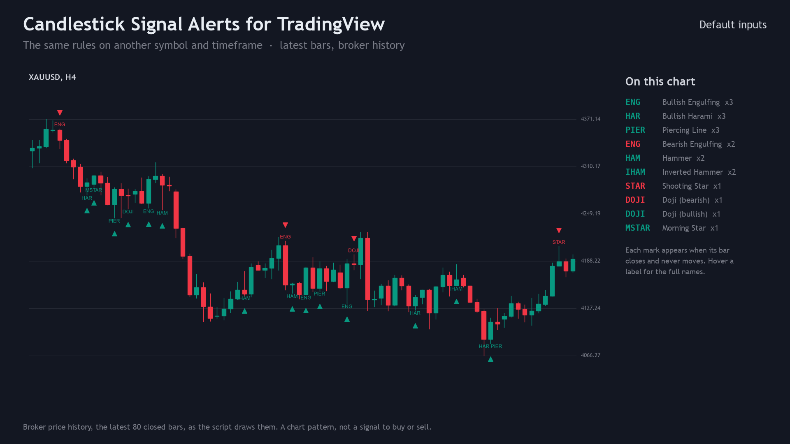
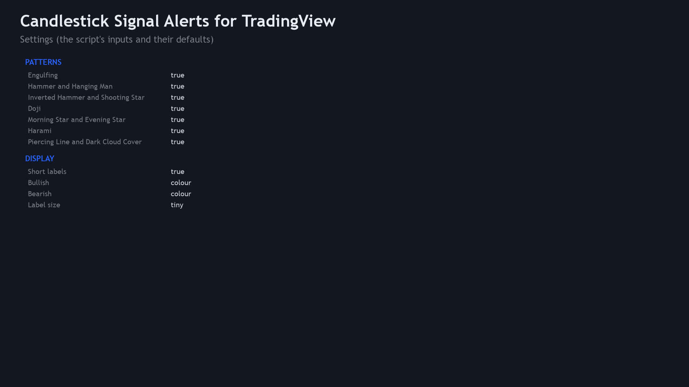
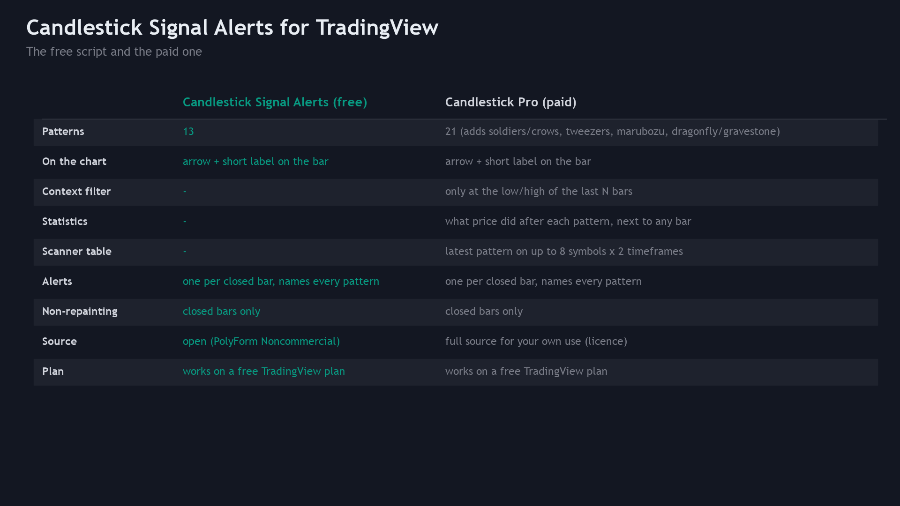
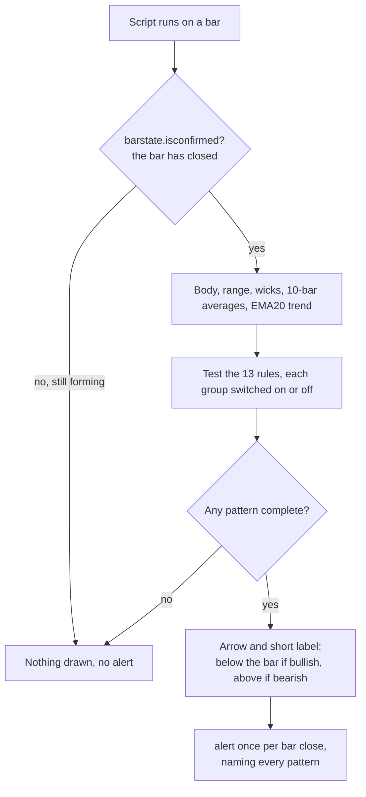

<p align="center"></p>

# Candlestick Signal Alerts for TradingView (Pine Script v6)

A free TradingView indicator that marks 13 classic candlestick patterns on the chart with an arrow and a short label,
**on closed bars only**, and can send one alert per bar that names every pattern it completed. Pine Script v6 source,
a Python reference of the rules, and the test that checks the script against the reference bar by bar.

**Website:** [allanninal.dev](https://www.allanninal.dev) · MetaTrader editions: [allanninal.dev/mql5 (indicators)](https://www.allanninal.dev/mql5/#indicators)
· **Contact:** message me on [LinkedIn](https://www.linkedin.com/in/allanninal/).



> It is an indicator, not a strategy. It draws marks and places no trades. Nothing here is a profit claim
> (see [Honest limits](#honest-limits)).

## Contents

1. [Install in the Pine Editor](#install-in-the-pine-editor)
2. [What it is and who it is for](#what-it-is-and-who-it-is-for)
3. [How it works](#how-it-works)
4. [Non-repainting](#non-repainting)
5. [Inputs and alerts](#inputs-and-alerts)
6. [Tests](#tests)
7. [Honest limits](#honest-limits)
8. [Free vs Pro](#free-vs-pro)
9. [Licence](#licence)

## Install in the Pine Editor

Works on every TradingView plan, including the free Basic plan. The script is not published on TradingView; you add it
from this source.

1. Open [`pine/CandlestickSignalAlerts.pine`](pine/CandlestickSignalAlerts.pine) and copy the whole file (the "Raw"
   button, then select all).
2. On a TradingView chart, open the **Pine Editor** tab at the bottom, create a new indicator and replace its text with
   the copied code.
3. Click **Save**, then **Add to chart**. The indicator appears as "Candle Alerts" and is kept in your own scripts.

To get alerts: right-click the chart, **Add alert**, choose **Candlestick Signal Alerts** as the condition and then
either **Any alert() function call** (one message per closed bar that names every pattern) or **Bullish pattern** /
**Bearish pattern**. Free plans limit how many alerts can be active at once.

## What it is and who it is for

**What:** 13 textbook candlestick patterns found by fixed numeric rules. Each pattern gets an arrow (green up for a
bullish pattern below the bar, red down for a bearish one above it) and a short label (`ENG`, `HAM`, `HANG`, `IHAM`,
`STAR`, `DOJI`, `MSTAR`, `ESTAR`, `HAR`, `PIER`, `DCC`) on the bar that **completes** it. Hover a label for the full
names.

**For:** traders who read candles and want the patterns found for them, with a definition they can read and check.

**Not for:** anyone who expects a pattern to predict direction. A pattern describes the shape of one to three bars.

| | |
|---|---|
|  |  |
|  |  |

Image notes: the charts are drawn from the Python reference on broker price history, which the script matches bar for
bar (see [Tests](#tests)); the rules and settings sheets are illustrations, not TradingView captures.

## How it works

### The measures

Let `O, H, L, C` be a bar's open, high, low, close and `k` the bar being decided (the bar that just closed).

| Measure | Formula |
|---|---|
| body | `abs(C - O)` |
| range | `H - L` |
| upper wick | `H - max(O, C)` |
| lower wick | `min(O, C) - L` |
| average body, average range | simple average of the body / range of the **10 bars before** `k` (`k-10 ... k-1`) |
| trend at bar `j` | `+1` if `C[j] > EMA20[j]`, `-1` if below, `0` otherwise. `EMA20` is seeded with the average of the first 20 closes, then `EMA[i] = EMA[i-1] + 2/21 * (C[i] - EMA[i-1])` (the same as `ta.ema`) |
| tie tolerance | comparisons treat values within `1e-9 x price` as equal, so rounding noise on exact ties decides nothing |

A bar is *bullish* if `C > O`, *bearish* if `C < O`.

### The 13 patterns

`b` = body of `k`, `r` = range of `k`, `u` / `w` = upper / lower wick of `k`, `p = k-1`, `q = k-2`, `ab` = average body,
`ar` = average range, `t1, t2, t3` = trend at `k-1, k-2, k-3`.

| # | Pattern | Direction | Rule (all conditions) |
|---|---|---|---|
| 0 | Bullish Engulfing | + | `p` bearish, `k` bullish, `O[k] <= C[p]`, `C[k] >= O[p]`, `b > body[p]`, `t2 < 0` |
| 1 | Bearish Engulfing | - | mirror: `p` bullish, `k` bearish, `O[k] >= C[p]`, `C[k] <= O[p]`, `b > body[p]`, `t2 > 0` |
| 2 | Hammer | + | `w >= 2b`, `u <= 0.1r`, `w >= 0.6r`, `r > 0`, `t1 < 0` |
| 3 | Hanging Man | - | the same shape, `t1 > 0` |
| 4 | Inverted Hammer | + | `u >= 2b`, `w <= 0.1r`, `u >= 0.6r`, `r > 0`, `t1 < 0` |
| 5 | Shooting Star | - | the same shape, `t1 > 0` |
| 6 | Doji | `-t1` | `b <= 0.05r`, `r >= 0.5 ar`, `r > 0`, `t1 != 0` (direction is against the trend before it) |
| 7 | Morning Star | + | `q` bearish with `body[q] >= ab`; `body[p] <= 0.3 body[q]`; `min(O[p], C[p]) <= C[q]`; `k` bullish and `C[k] > (O[q]+C[q])/2`; `t3 < 0` |
| 8 | Evening Star | - | mirror: `q` bullish, `max(O[p], C[p]) >= C[q]`, `k` bearish, `C[k] < (O[q]+C[q])/2`, `t3 > 0` |
| 9 | Bullish Harami | + | `p` bearish with `body[p] >= ab`, `k` bullish, `O[k] >= C[p]`, `C[k] <= O[p]`, `b < body[p]`, `t2 < 0` |
| 10 | Bearish Harami | - | mirror: `p` bullish, `k` bearish, `O[k] <= C[p]`, `C[k] >= O[p]`, `b < body[p]`, `t2 > 0` |
| 11 | Piercing Line | + | `p` bearish with `body[p] >= ab`, `k` bullish, `O[k] <= C[p]`, `(O[p]+C[p])/2 < C[k] < O[p]`, `t2 < 0` |
| 12 | Dark Cloud Cover | - | mirror: `p` bullish, `k` bearish, `O[k] >= C[p]`, `O[p] < C[k] < (O[p]+C[p])/2`, `t2 > 0` |

The inputs group the 13 into seven switches. Several patterns can complete on the same bar; the label then lists each.
The same rules, with the same numbering, are used by the MetaTrader editions
([allanninal/candlestick-signal-alerts](https://github.com/allanninal/candlestick-signal-alerts)).

### Per-bar flow



### How often patterns appear

On broker history of EURUSD, GBPJPY, XAUUSD and BTCUSD (H1, 375,988 bars), the same rules mark about **261 bars per
1,000**, so roughly one closed bar in four carries a mark. Doji (43.6 per 1,000) and engulfing (38.6 bullish, 39.9
bearish) are the most common; the three-bar stars are rare (5.6 and 5.9). The count and its script are in the MetaTrader
repository ([`docs/data/pattern-frequency.json`](https://github.com/allanninal/candlestick-signal-alerts/blob/main/docs/data/pattern-frequency.json));
it counts marks only and says nothing about what price does afterwards.

## Non-repainting

- Every pattern, mark and alert is gated by `barstate.isconfirmed`: nothing is decided on the forming bar.
- Each decision reads only the bar that closed and earlier bars (the pattern's own bars, the 10 bars before, and the
  EMA, which is recursive). No `request.security`, no future bars.
- Alerts use `alert.freq_once_per_bar_close`, so a pattern that appears and vanishes inside a bar never sends anything.

This was tested, not only reasoned about: see [Tests](#tests).

## Inputs and alerts

| Input | Default | Meaning |
|---|---|---|
| Engulfing, Hammer and Hanging Man, Inverted Hammer and Shooting Star, Doji, Morning Star and Evening Star, Harami, Piercing Line and Dark Cloud Cover | all on | Switch a group of patterns on or off |
| Short labels | on | Write the short name next to each arrow (hover for full names). TradingView keeps the latest 500 labels |
| Bullish, Bearish | `#089981`, `#F23645` | Colours (TradingView's own candle colours by default) |
| Label size | tiny | tiny, small or normal |

Every input has a tooltip in the settings dialog. Two hidden plots, "Bullish patterns (bit mask)" and "Bearish patterns
(bit mask)", show in the Data Window: bit `n` is pattern `n` of the table above. The tests read them.

| Alert condition | Message |
|---|---|
| Any alert() function call | `EURUSD 60: bullish Bullish Engulfing, Hammer` (every pattern of the bar, bullish and bearish) |
| Bullish pattern | `Bullish candlestick pattern on {{ticker}} {{interval}}` |
| Bearish pattern | `Bearish candlestick pattern on {{ticker}} {{interval}}` |

## Tests

Run on this exact code:

| Check | Result |
|---|---|
| Compile (TradingView's Pine v6 compiler) | 0 errors, 0 warnings |
| Parity: script vs [`tests/reference.py`](tests/reference.py), every bar | 0 mismatches: 13,786 pattern bars (all patterns on) and 11,748 (Doji off), 12 series, 60,000 bars |
| Repaint: re-run on the series cut at 3 points, closed bars compared with the full run | 0 of 292,776 closed-bar values changed |

Data: the latest 5,000 closed bars of EURUSD, GBPJPY, XAUUSD and BTCUSD on M15, H1 and H4 (12 series, broker history),
with all patterns on and with Doji off. The script runs locally in [PineTS](https://github.com/LuxAlgo/PineTS), an
open-source Pine v6 runtime. To repeat it on your own bars:

```bash
cd tests/runner && npm install && cd ../..          # PineTS (AGPL-3.0), installed for testing only
python3 -m venv .venv && . .venv/bin/activate && pip install -r requirements.txt
python3 tests/check_pine.py <folder of SYMBOL_TF.csv files: time (unix ms), open, high, low, close>
```

It prints the mismatches per configuration, the repaint count and `ALL PASS` or `FAIL`. The price files used for the
numbers above are not in this repository (they are broker price data).

## Honest limits

- **A pattern is not a strategy.** No stop-loss, position sizing or exit rules are provided or implied, and the rules
  were not optimised or back-tested for profit. In the author's own check of how price moved after these patterns, the
  moves were close to what follows any bar: no edge is claimed anywhere.
- **The definitions are one reading.** Candlestick names have several textbook definitions; other tools (including
  TradingView's built-in pattern scripts) use other thresholds, so marks will differ.
- **The trend test is simple:** the close against its 20-period EMA, not a swing analysis.
- **Frequent marks.** About one closed bar in four carries a mark at default settings. Switch groups off to cut noise.
- **Label cap.** TradingView keeps the latest 500 labels per script; older arrows stay, older labels drop off.
- **Scope of the tests.** PineTS is a separate runtime from TradingView's; the script was compile-checked with
  TradingView's compiler, and its marks were matched in PineTS on the 12 series above. Other symbols, timeframes and
  data feeds are not covered by these numbers.

## Free vs Pro

| | Free: Candlestick Signal Alerts | Paid: Candlestick Pro |
|---|---|---|
| Patterns | 13 | 21 |
| Arrows, short labels, alerts | yes | yes |
| Filter: only at the low or high of the last N bars | no | yes |
| Statistics table (what price did after each pattern, next to any bar) | no | yes |
| Table of the latest pattern on several symbols and timeframes | no | yes |
| Closed bars only, no repaint | yes | yes |
| Source | this repository (PolyForm Noncommercial) | delivered to the buyer, personal-use licence |
| Price | free | paid, one-time |

No need to buy the paid script to use this one: the free indicator is complete on its own. Candlestick Pro is
described at [allanninal.dev](https://www.allanninal.dev) (page coming soon).

## Licence

Copyright 2026 Allan Niñal (<https://www.allanninal.dev>). Licensed under the
[PolyForm Noncommercial License 1.0.0](LICENSES/PolyForm-Noncommercial-1.0.0.md): source-available, free for personal
and other noncommercial use, not for commercial use. Text: [`LICENSE`](LICENSE). Please do not republish this script on
TradingView or elsewhere as your own. The candlestick patterns are textbook definitions; the code is original. Trading
involves risk; the software is provided as is.

---

**Website:** [allanninal.dev](https://www.allanninal.dev) · [MetaTrader editions](https://www.allanninal.dev/mql5/#indicators)
· Questions: message me on [LinkedIn](https://www.linkedin.com/in/allanninal/).
